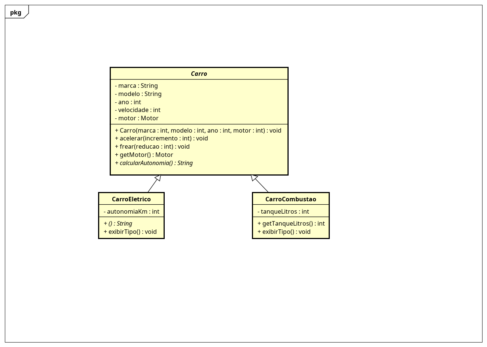
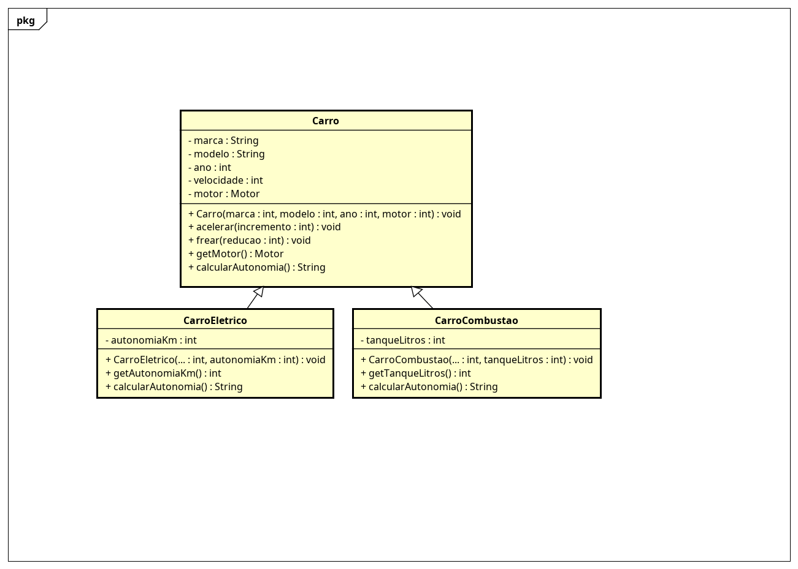

## Classe abstrata: o molde invisível (Aula 8)

`Carro` virou uma **classe abstrata** (`public abstract class Carro`). No mundo real ninguém tem um "carro genérico" — todo carro é de algum tipo (elétrico, a combustão). Por isso o `Carro` deixou de poder ser instanciado: ele é só o **molde** que as filhas concretas seguem.



No diagrama, o nome `Carro` e os métodos `calcularAutonomia()`/`exibirTipo()` aparecem em *itálico* — a convenção UML para indicar "abstrato".

```java
// Carro c = new Carro(...);  // NÃO COMPILA: "Carro is abstract; cannot be instantiated"
Carro tesla = new CarroEletrico("Tesla", "Model 3", 2024, new Motor(150, "Elétrico"), 500); // OK
```

A mãe agora tem dois **métodos abstratos** — sem corpo, terminam em `;` — que **obrigam** toda filha concreta a implementar:

| Método abstrato (em `Carro`)   | `CarroEletrico` implementa         | `CarroCombustao` implementa          |
|--------------------------------|------------------------------------|--------------------------------------|
| `exibirTipo() : void`          | "Sou um Carro Elétrico."           | "Sou um Carro a Combustão."          |
| `calcularAutonomia() : String` | pela `autonomiaKm`                 | `tanqueLitros` × consumo (12 km/l)   |

Se uma filha esquecer de implementar um método abstrato, o código **não compila** — o compilador garante o contrato. Métodos abstratos são implicitamente `public`.

## Polimorfismo de sobrescrita (Aula 7)

Todas as subclasses sabem responder ao mesmo comando `calcularAutonomia()`, cada uma do seu jeito. A mãe `Carro` define o método (o **contrato**) com uma resposta genérica; cada filha o **sobrescreve** com `@Override` e a sua própria conta.



| Classe            | `calcularAutonomia()` retorna                                  |
|-------------------|----------------------------------------------------------------|
| `Carro` (mãe)     | mensagem genérica (contrato)                                   |
| `CarroEletrico`   | a `autonomiaKm` direto (a carga da bateria já é dada em km)     |
| `CarroCombustao`  | `tanqueLitros` × consumo (12 km/l)                             |

```java
List<Carro> frota = new ArrayList<>();
frota.add(new CarroEletrico("Tesla", "Model 3", 2024, new Motor(150, "Elétrico"), 500));
frota.add(new CarroCombustao("Volkswagen", "Gol", 2022, new Motor(110, "Flex"), 55));

for (Carro carro : frota) {
    System.out.println(carro.calcularAutonomia()); // mesmo comando, resultados diferentes
}
```

O Java escolhe a conta certa pelo objeto real, sem nenhum `if` de tipo — essa é a mágica do polimorfismo.

## Herança: Carro como superclasse (Aula 6)

O `Carro` virou a **superclasse** (mãe). Dois subtipos herdam dele com `extends`, ganham tudo o que o `Carro` tem (marca, modelo, ano, velocidade, motor, `acelerar`/`frear`) e acrescentam o que é exclusivo:

| Subclasse         | Herda de | Atributo exclusivo      |
|-------------------|----------|-------------------------|
| `CarroEletrico`   | `Carro`  | `autonomiaKm` (int, km) |
| `CarroCombustao`  | `Carro`  | `tanqueLitros` (int, L) |

O construtor de cada filha chama `super(marca, modelo, ano, motor)` para inicializar a parte que é da mãe, e depois inicializa o seu próprio atributo.

```java
Motor motorEletrico = new Motor(150, "Elétrico");
CarroEletrico tesla = new CarroEletrico("Tesla", "Model 3", 2024, motorEletrico, 500);

tesla.acelerar(80);        // método herdado de Carro
tesla.getAutonomiaKm();    // atributo exclusivo da filha
```

## Por que a filha não altera os atributos private da mãe diretamente?

Porque `private` significa "só esta classe". Nem a subclasse escapa disso — é o **encapsulamento** (Aula 3) sendo respeitado. A filha só chega aos dados da mãe pelo `super()` (no nascimento) ou pelos getters/setters públicos. Assim, toda validação que mora na mãe continua valendo: se a filha pudesse escrever `this.marca` direto, ela poderia burlar as regras do construtor da mãe e deixar o objeto inconsistente. (Se quiséssemos dar acesso direto à filha, usaríamos `protected` — mas isso amplia a exposição, então só quando fizer sentido.)

## Estrutura de pastas

```
FiapCarro/
├── Carro.asta                (modelo UML — feito no Astah)
├── docs/
│   ├── diagrama_carro_aula7.png   (polimorfismo)
│   └── diagrama_carro_aula8.png   (classe abstrata)
└── src/
    ├── module-info.java
    └── br/com/fiapcarro/
        ├── model/Carro.java            (superclasse ABSTRATA)
        ├── model/CarroEletrico.java    (subclasse concreta)
        ├── model/CarroCombustao.java   (subclasse concreta)
        ├── model/Motor.java
        └── main/SistemaPrincipal.java
```
